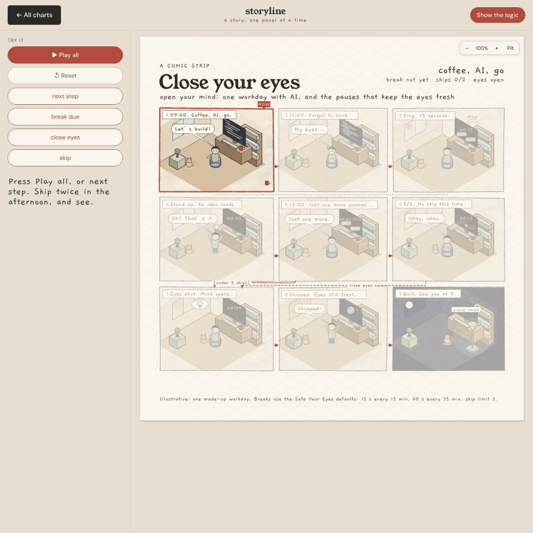
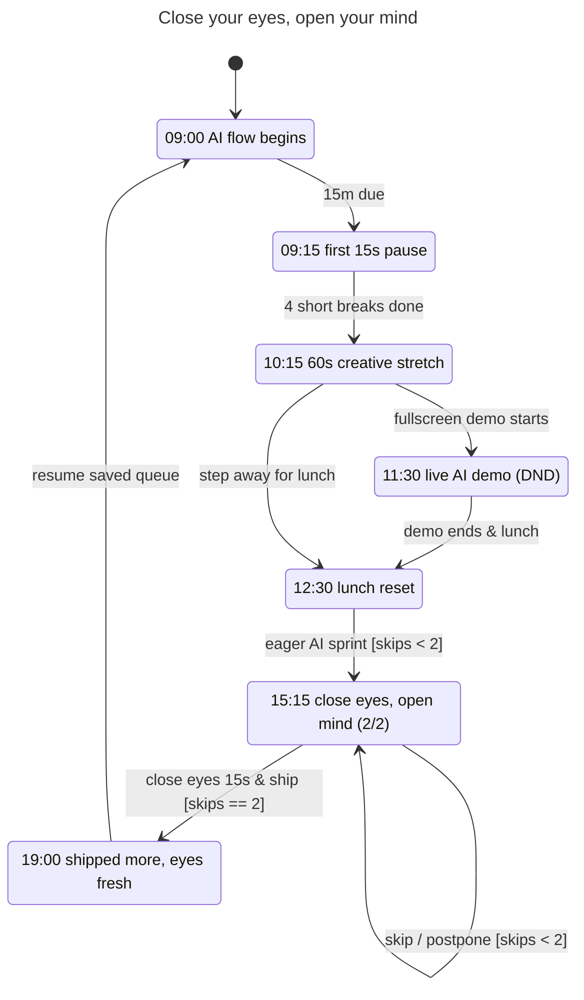

# Close Your Eyes, Open Your Mind

AI makes us build faster than ever—which also makes it effortless to stare at a screen for hours without blinking.
Safe Your Eyes protects your vision so you can close your eyes, open your mind, spark sharper creative ideas, and steer AI even more effectively.

Illustrated with [tinycharts](https://github.com/tunglt1810/tinycharts).
Each section below matches one of the seven parts in the time-lapse above.
Read the technical details in [the specification](specs/SPEC.md).

## 1. 09:00 — AI Flow Begins

AI supercharges every prompt, diff, and build, making it easy to get pulled into a nonstop sprint.
You start `safe-your-eyes`, and the single-instance daemon sits quietly in the system tray.
In `Waiting`, it creates no graphics context and uses 0% GPU while counting down 15 minutes to your first pause.

## 2. 09:15 — First 15-Second Pause

Ten seconds before the break, a desktop notification appears with a soft synthesized pre-break chime (`PreBreak`).
At `00:00`, the daemon launches an on-demand native overlay with a cozy dark-roast card and a `00:15` countdown.
For the first 2 seconds, `shortcut_disable_secs` blocks `Space` and `Esc` so an eager mid-prompt keypress never skips your rest.
You gently rest your eyes and clear tunnel vision until the post-break chime (`PostBreak`) calls you back and the overlay exits (`0% GPU`).

## 3. 10:15 — 60-Second Creative Stretch (4:1)

After four short breaks (75 minutes), `BreakQueue` stages a 60-second `Long` break in the default 4:1 rhythm.
The `01:00` overlay pulls you away from the screen to stand, stretch, and refill your mug.
Away from the stream of prompts, your mind has space to connect dots—and the boldest ideas land before you sit back down.

## 4. 11:30 — Live AI Demo (Do Not Disturb)

You share your sharper plan fullscreen on a live call.
`DoNotDisturbPolicy` detects fullscreen mode and holds breaks back so your demo runs uninterrupted.

## 5. 12:30 — Lunch Reset (Smart Pause)

You step away from the keyboard to recharge over lunch.
`SmartPausePolicy` detects idle time, moves `Scheduler` into `Resting`, and resets your break cycle and skip counter cleanly when you return.

## 6. 15:15 — Close Your Eyes, Open Your Mind (Skip Limit 2/2)

Deep in an afternoon AI sprint, you skip or postpone two breaks in a row.
At `2/2`, `SkipLimitPolicy` locks both `Skip` and `Postpone` on the next break.
With no escape hatch, you gently close your eyes for 15 seconds—stepping out of reactive prompting, opening your mind, and coming back with a clearer, smarter prompt when the post-break chime rings and resets skips to `0`.

## 7. 19:00 — Shipped More, Eyes Still Fresh

At dusk, you shipped better work with AI and still have zero evening eye strain.
You run `safe-your-eyes --quit` to stop the daemon cleanly.
With `persist_state` enabled, the daemon saves your `BreakQueue` position to `session.toml`, ready to resume tomorrow morning at 09:00.

## Workday State Diagram

## Verified Workday Rules

- **Do Not Disturb never interrupts a fullscreen demo**: While a fullscreen presentation is active, Safe Your Eyes holds the break overlay back.
- **Consecutive skips stop at 2/2**: `SkipLimitPolicy` locks `Skip` and `Postpone` at `2/2` so over-sprinting never costs your eyes a real 15-second rest.
- **Smart Pause resets cleanly after lunch**: Stepping away for an extended idle period clears consecutive skips and leaves no overlay open.
